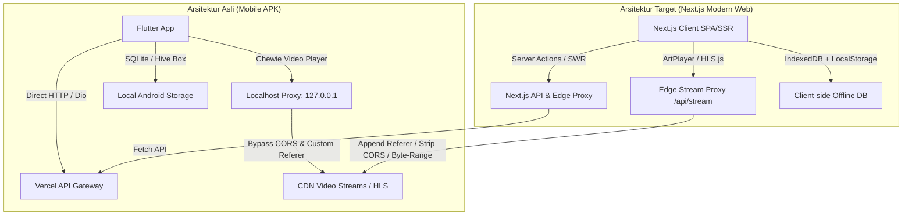
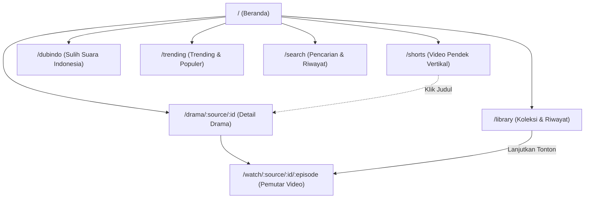
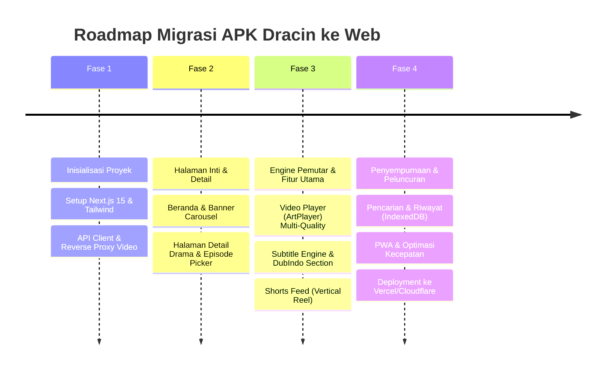

# Product Requirements Document (PRD)
## Migrasi Aplikasi Android "Dracin Zek" Menjadi Platform Web Streaming Modern

---

## 1. Executive Summary & Background

### 1.1 Ringkasan Proyek
Aplikasi Android **Dracin Zek** (`com.zekri.dracin.dracin_flutter`, versi `1.0.24`) merupakan aplikasi streaming video populer yang berfokus pada konten **Drama China (Dracin)**, **Shorts Drama (Vertical Micro-Dramas)**, dan konten **Sulih Suara Bahasa Indonesia (DubIndo)**. Berdasarkan hasil dekompilasi dan analisis biner aplikasi, aplikasi ini dibangun menggunakan framework **Flutter** dan mengonsumsi API agregator multi-provider (`DramaBox`, `NetShort`, dan `Melolo`) yang di-host pada `https://dracinzek.vercel.app/api`.

Inisiatif proyek ini adalah melakukan konversi dan modernisasi dari platform APK (Android Native) menjadi **Platform Web Responsif & PWA (Progressive Web App)** berbasis **Next.js 15 / React**, sehingga pengguna dapat menonton langsung dari browser desktop, tablet, maupun smartphone tanpa perlu mengunduh dan memasang file APK secara manual.

### 1.2 Tujuan Utama (Objectives)
1. **Aksesibilitas Multi-Platform**: Memungkinkan pengguna mengakses ribuan episode drama China langsung dari web browser (Chrome, Safari, Firefox, Edge) di mobile maupun desktop.
2. **Zero-Install Experience**: Menghilangkan hambatan instalasi APK manual dan peringatan keamanan Play Protect.
3. **Peningkatan SEO & Organic Discovery**: Tiap judul drama memiliki halaman web dengan metadata SEO lengkap (OpenGraph, schema.org) untuk menjaring jutaan pencarian Google (misal: *"nonton drama china sub indo"*).
4. **Kecepatan & Responsivitas Streaming**: Menggantikan mobile video proxy dengan Edge Video Proxy untuk mengatasi kendala CORS dan anti-hotlinking bawaan web.
5. **Modern UX & Feature Parity**: Menghadirkan seluruh fitur unggulan APK (player multi-kualitas, pengaturan subtitle, TikTok-style shorts, riwayat tontonan, dan bookmark) dengan antarmuka web modern.

---

## 2. Hasil Dekompilasi & Reverse Engineering APK

Berikut adalah temuan teknis mendalam dari analisis biner APK `dracin-v1.0.24.apk`:

### 2.1 Identitas & Metadata APK
| Parameter | Nilai Temuan Biner |
| :--- | :--- |
| **App Name** | Dracin Zek |
| **Package ID** | `com.zekri.dracin.dracin_flutter` |
| **Version Name / Code** | `1.0.24` / `10024` |
| **Framework** | Flutter (Dart AOT Snapshot ARM64/ARMv7/x86_64) |
| **Target SDK / Min SDK** | Android SDK 34 / 21 |
| **State Management** | Flutter Riverpod |
| **Router** | GoRouter |
| **Video Engine** | Chewie / video_player + Custom Subtitle Engine |
| **Local Storage** | Hive / Hive Flutter + Sqflite |
| **Backend API Host** | `https://dracinzek.vercel.app/api` |
| **Repository Sumber** | `https://github.com/zexry619/dracin-app-android` |

### 2.2 Inventaris Layanan & Modul Sumber (44 Berkas Inti Dart)
```
dracin_flutter/
├── core/
│   ├── network/api_client.dart                # HTTP Client (Dio) dengan base URL Vercel
│   ├── router/app_router.dart                 # Rute navigasi GoRouter
│   ├── services/video_proxy/                  # Localhost HTTP Proxy (127.0.0.1) untuk bypass CORS/Referer
│   ├── services/update_service.dart           # Checker update versi APK
│   ├── theme/app_theme.dart                   # Dark mode theme & color tokens
│   └── utils/subtitle_parser.dart             # Parser subtitle VTT & SRT
├── features/
│   ├── home/                                  # Banner carousel, trending list, feeds
│   ├── trending/                              # Tab multi-source (DramaBox, NetShort, Melolo)
│   ├── category/                              # Filter genre, katalog, & DubIndo (Sulih Suara)
│   ├── shorts/                                # Layar video pendek vertikal (swipe up/down)
│   ├── drama_detail/                          # Info drama, sinopsis, episode picker, cover
│   ├── video_player/                          # Watch screen, quality selector, subtitle styling, prefetch
│   ├── search/                                # Pencarian judul, riwayat pencarian, kata kunci populer
│   ├── favorites/                             # Simpanan drama favorit pengguna
│   ├── watch_history/                         # Riwayat tontonan & penanda detik terakhir
│   ├── library/                               # Hub terpadu: Favorit, Riwayat, Unduhan
│   └── downloads/                             # Offline manager (khusus platform mobile)
```

### 2.3 Pemetaan Endpoint API yang Ditemukan
Semua endpoint beroperasi di bawah endpoint dasar: `https://dracinzek.vercel.app/api`

| Kategori Sumber | Path Endpoint | Parameter / Payload | Fungsi |
| :--- | :--- | :--- | :--- |
| **DramaBox** | `/dramabox/foryou` | - | Beranda drama rekomendasi |
| | `/dramabox/latest` | `page` | Rilis drama terbaru |
| | `/dramabox/trending` | `page` | Drama paling banyak ditonton |
| | `/dramabox/vip` | `page` | Drama kategori premium/eksklusif |
| | `/dramabox/theater` | `page` | Drama bioskop/panjang |
| | `/dramabox/dubbed` | `page` | Drama sulih suara (Dub Indo) |
| | `/dramabox/randomdrama` | - | Rekomendasi acak |
| | `/dramabox/populersearch`| - | Kata kunci pencarian terpopuler |
| | `/dramabox/search` | `q` / `keyword`, `page` | Pencarian drama DramaBox |
| | `/dramabox/detail` | `dramaId` | Detail lengkap & daftar episode |
| | `/dramabox/stream` | `dramaId`, `episodeNumber` | URL video streaming & subtitle |
| | `/dramabox/category/content` | `categoryId`, `page` | Konten berdasarkan kategori |
| **NetShort** | `/netshort/foryou` | - | Feed video pendek rekomendasi |
| | `/netshort/trending` | `page` | Short drama trending |
| | `/netshort/explore` | `page` | Eksplorasi kategori |
| | `/netshort/search` | `keyword`, `page` | Pencarian NetShort |
| | `/netshort/detail` | `dramaId` | Detail & episode NetShort |
| **Melolo** | `/melolo/latest` | `page` | Rilis terbaru Melolo |
| | `/melolo/trending` | `page` | Trending Melolo |
| | `/melolo/search` | `q` | Pencarian Melolo |
| | `/melolo/detail` | `dramaId` | Detail drama Melolo |
| | `/melolo/stream` | `dramaId`, `episodeNumber` | Link streaming Melolo |
| **Kategori Khusus** | `/category/dubindo` | `page` | Halaman khusus Sulih Suara Indonesia |
| **Sistem** | `/version/latest` | - | Cek status rilis & versi terkini |

---

## 3. Analisis Kesenjangan Teknis (APK vs. Web) & Solusi Arsitektur

Saat memindahkan aplikasi Flutter mobile ke Web, terdapat perbedaan arsitektur kritis yang wajib diantisipasi:



### 3.1 Tantangan 1: CORS & Anti-Hotlinking pada Video Stream
* **Problem**: Sumber CDN DramaBox/NetShort/Melolo memvalidasi header HTTP `Referer` dan `Origin`. Browser memblokir pengubahan header `Referer` secara bebas pada elemen `<video>` atau `fetch()`, serta memberlakukan aturan CORS yang ketat.
* **Solusi Web**: Implementasikan endpoint **Next.js Stream Proxy** (`/api/proxy/video?url=...`). Proxy ini meneruskan permintaan, menyisipkan `Referer: https://www.dramabox.com/` atau `https://netshort.com/`, dan meneruskan header HTTP `Range` (206 Partial Content) agar fitur *seeking/scrubbing* video tetap instan dan lancar.

### 3.2 Tantangan 2: Format & Rendering Subtitle
* **Problem**: Aplikasi mobile menguraikan file VTT/SRT secara lokal di Dart (`subtitle_parser.dart`) dengan fitur kustomisasi posisi vertikal dan ukuran font.
* **Solusi Web**: Menggunakan parser WebVTT standar dan engine styling bawaan player web (**ArtPlayer** / **Video.js**), yang memungkinkan kustomisasi CSS untuk ukuran teks, warna font, bayangan teks (stroke/shadow), dan offset posisi subtitle di atas kontrol bar.

### 3.3 Tantangan 3: Penyimpanan Riwayat & Bookmark Tanpa Login Wajib
* **Problem**: APK menyimpan daftar tontonan dan favorit langsung di biner Hive lokal tanpa registrasi akun.
* **Solusi Web**: Gunakan **IndexedDB** (via `idb-keyval` atau `zustand/persist`) di sisi peramban. Pengguna langsung bisa menyimpan favorit dan riwayat hingga ribuan judul tanpa perlu login. Sediakan opsi login cloud (Google Auth / Supabase) untuk sinkronisasi antar-perangkat jika pengguna menginginkannya di masa depan.

---

## 4. Spesifikasi Kebutuhan Fungsional (Feature Requirements)

### 4.1 Halaman Beranda (Home Page)
* **Hero Banner Carousel**: Menampilkan 5 drama unggulan terpopuler dengan poster lanskap, judul, sinopsis singkat, badge kategori (VIP / DubIndo / Trending), dan tombol "Tonton Sekarang".
* **Kategori Tab Sumber**: Pilihan sumber aktif (Semua, DramaBox, NetShort, Melolo).
* **Section Horisontal**:
  - *Sedang Hangat (Trending)*
  - *Rekomendasi Untuk Anda (For You)*
  - *Rilis Terbaru (Latest Episodes)*
  - *Sulih Suara Indonesia (DubIndo)*
  - *Drama VIP & Eksklusif*
* **Infinite Scroll / Paginasi**: Memuat data berikutnya saat pengguna mencapai batas bawah layar.

### 4.2 Halaman Khusus Sulih Suara Indonesia (DubIndo)
* Filter khusus untuk drama dengan audio dubbing Bahasa Indonesia.
* Penanda visual (Badge "DUB INDO") yang menonjol pada setiap thumbnail kartu.
* Filter berdasarkan status (Tamat / Sedang Tayang) dan genre (Romance, CEO, Reinkarnasi, Aksi).

### 4.3 Fitur Shorts (Vertical Drama Feed - TikTok/Reels Style)
* Antarmuka vertikal layar penuh (9:16 aspect ratio).
* Dukungan navigasi swipe atas/bawah pada perangkat mobile touch, dan tombol panah/keyboard pada desktop.
* Auto-play saat item berada di viewport, auto-pause saat di-scroll.
* Overlay info: Judul drama, episode ke-X, tombol buka halaman detail drama penuh, dan tombol bagikan (Share Web Share API).

### 4.4 Halaman Detail Drama (`/drama/[provider]/[id]`)
* Poster resolusi tinggi dengan efek *ambient background blur*.
* Informasi metadata: Judul resmi, judul alternatif, tag genre, jumlah episode, rating/status, sinopsis lengkap yang dapat di-expand (*Read More*).
* Tombol Aksi:
  - **Mulai Menonton** (melompat ke episode 1 atau episode terakhir di riwayat tontonan)
  - **Tambah ke Favorit** (toggle icon bookmark)
  - **Bagikan Link** (copy URL atau Web Share)
* **Episode Grid Selector**:
  - Tampilan grid nomor episode (1, 2, 3, ... N).
  - Indikator episode yang sudah ditonton (*watched state* dengan progress bar).
  - Tab range episode untuk drama dengan jumlah episode banyak (misal: 1-50, 51-100).

### 4.5 Pemutar Video (Watch Screen - `/watch/[provider]/[id]/[episode]`)
* **Pemutar Video Kinerja Tinggi** (ArtPlayer / HLS.js):
  - **Quality Selector**: Pilihan resolusi otomatis dan manual (360p, 480p, 720p, 1080p).
  - **Subtitle Engine**: Pilihan subtitle Bahasa Indonesia, Bahasa Inggris, atau Matikan Subtitle.
  - **Subtitle Customizer**: Pengaturan ukuran font (Kecil, Normal, Besar), posisi vertikal teks, dan warna latar teks.
  - **Playback Speed**: Pengatur kecepatan (0.5x, 0.75x, 1.0x, 1.25x, 1.5x, 2.0x).
  - **Auto Next Episode**: Hitung mundur 5 detik di akhir video untuk memutar episode berikutnya secara otomatis.
  - **Episode Quick Drawer / Sidebar**: Memilih episode lain tanpa perlu meninggalkan layar pemutar.
  - **Hotkeys (Keyboard Shortcuts)**: Spasi (Play/Pause), Panah Kiri/Kanan (Skip 10 detik), Panah Atas/Bawah (Volume), F (Fullscreen), M (Mute).
  - **Progress Persistence**: Menyimpan detik tontonan setiap 5 detik ke penyimpanan lokal.

### 4.6 Pencarian & Eksplorasi (`/search`)
* Input pencarian responsif dengan debounce (300ms).
* **Kata Kunci Populer**: Menampilkan tag tren dari endpoint `/dramabox/populersearch`.
* **Riwayat Pencarian**: Daftar pencarian terakhir yang tersimpan di browser pengguna dengan opsi hapus satu per satu atau bersihkan semua.
* **Hasil Multi-Source**: Tab hasil pencarian yang mengelompokkan hasil dari DramaBox, NetShort, dan Melolo.

### 4.7 Perpustakaan Pengguna (`/library`)
* **Tab Favorit**: Daftar drama yang disimpan oleh pengguna dengan fitur filter dan sortir.
* **Tab Riwayat (History)**: Daftar episode yang pernah ditonton lengkap dengan persentase durasi tontonan dan tanggal tontonan terakhir.
* Opsi ekspor/impor data lokal dalam format JSON agar pengguna dapat memindahkan data favorit ke peramban lain.

---

## 5. Arsitektur Teknologi & Rekomendasi Stack Web

```
+-------------------------------------------------------------+
|                      CLIENT BROWSER                         |
|  Next.js 15 (App Router) + Tailwind CSS + Lucide Icons      |
|  ArtPlayer / HLS.js (Video) + Swiper (Shorts) + Zustand     |
+-------------------------------------------------------------+
                              |
                     HTTPS / Fetch API
                              |
+-------------------------------------------------------------+
|                NEXT.JS EDGE & API ROUTES                     |
|  1. /api/proxy/video   -> Stream Relay + CORS + Range       |
|  2. /api/proxy/sub     -> Subtitle VTT/SRT Sanitizer        |
|  3. /api/dracin/*      -> Cached Gateway to Vercel Backend  |
+-------------------------------------------------------------+
                              |
                     Internal Upstream
                              |
+-------------------------------------------------------------+
|                 UPSTREAM BACKEND SERVICES                   |
|  https://dracinzek.vercel.app/api (DramaBox/NetShort/Melolo)|
|  wsrv.nl (Image CDN Proxy & WebP optimizer)                 |
+-------------------------------------------------------------+
```

### 5.1 Pilihan Komponen Stack
* **Framework**: **Next.js 15 (React 19)** dengan App Router untuk SSR + Static Rendering yang optimal untuk SEO.
* **Styling**: **Tailwind CSS v4** + Radix UI / Shadcn UI (desain bertema Dark Mode mirip Netflix/iQiyi).
* **Video Player**: **ArtPlayer.js** (alternatif: Video.js / Plyr). ArtPlayer dipilih karena memiliki performa tinggi di browser mobile, dukungan built-in subtitle VTT, kontrol kecepatan, thumbnail preview, dan UI kustom yang sangat fleksibel.
* **Shorts Swiper**: **Swiper.js** atau native CSS Scroll Snap (`scroll-snap-type: y mandatory`) untuk performa 60 FPS pada swipe video pendek.
* **State Management**: **Zustand** dengan persist middleware ke `localStorage` / `IndexedDB`.
* **Data Fetching**: **TanStack Query (React Query)** atau SWR untuk caching otomatis, revalidasi, dan *stale-while-revalidate*.
* **Image Optimization**: Menggunakan proxy gambar `https://wsrv.nl/?url=` (yang sudah digunakan oleh APK Dracin) dengan output format otomatis WebP/AVIF.

---

## 6. Desain Antarmuka & Sitemap



### 6.1 Layout Responsif
* **Mobile Layout (< 768px)**:
  - Bottom Navigation Bar 5-menu: `Beranda`, `Shorts`, `DubIndo`, `Cari`, `Koleksi`.
  - Header ramping dengan logo Dracin Zek dan avatar profil / pengaturan.
* **Desktop / Tablet Layout (>= 768px)**:
  - Header navigasi tetap di bagian atas dengan link cepat dan kolom pencarian langsung.
  - Tampilan grid multi-kolom (4-6 poster per baris).
  - Mode Bioskop (Cinema Mode) pada halaman pemutar video yang memperlebar layar hingga 85% lebar monitor.

---

## 7. Desain Teknis Proxy Streaming (CORS & Range Handling)

File rute Next.js API `/app/api/proxy/video/route.ts` dirancang untuk menangani streaming byte-range:

```typescript
// Contoh implementasi konseptual Streaming Proxy Next.js
export async function GET(request: Request) {
  const { searchParams } = new URL(request.url);
  const targetUrl = searchParams.get('url');
  const source = searchParams.get('source') || 'dramabox';

  if (!targetUrl) return new Response('Missing URL', { status: 400 });

  const referer = source === 'netshort' 
    ? 'https://netshort.com/' 
    : 'https://www.dramabox.com/';

  const headers: Record<string, string> = {
    'User-Agent': 'Mozilla/5.0 (Windows NT 10.0; Win64; x64) AppleWebKit/537.36',
    'Referer': referer,
  };

  const range = request.headers.get('range');
  if (range) headers['Range'] = range;

  const upstreamRes = await fetch(targetUrl, { headers });

  return new Response(upstreamRes.body, {
    status: upstreamRes.status,
    headers: {
      'Content-Type': upstreamRes.headers.get('content-type') || 'video/mp4',
      'Content-Length': upstreamRes.headers.get('content-length') || '',
      'Content-Range': upstreamRes.headers.get('content-range') || '',
      'Accept-Ranges': 'bytes',
      'Access-Control-Allow-Origin': '*',
    },
  });
}
```

---

## 8. Rencana Implementasi & Roadmap Pengembangan



### Fase 1: Inisialisasi & Lapisan API Proxy (Minggu 1)
- [ ] Inisialisasi repositori Next.js 15 dengan TypeScript dan Tailwind CSS di workspace `c:\Users\kita220825\Documents\project\dracin`.
- [ ] Implementasi Edge API Proxy (`/api/proxy/video` & `/api/proxy/subtitle`) untuk streaming lancar tanpa masalah CORS.
- [ ] Pembuatan wrapper API Client untuk semua endpoint DramaBox, NetShort, dan Melolo.

### Fase 2: Navigasi, Beranda, & Detail Drama (Minggu 2)
- [ ] Membangun tata letak responsif (Desktop Header & Mobile Bottom Nav).
- [ ] Implementasi Halaman Beranda lengkap dengan Hero Slider dan section kategori.
- [ ] Halaman Detail Drama (`/drama/[source]/[id]`) dengan daftar episode dan sinopsis.

### Fase 3: Pemutar Video & Fitur Unggulan (Minggu 3)
- [ ] Integrasi pemutar video (ArtPlayer / HLS.js) dengan pemilih kualitas (360p - 1080p).
- [ ] Integrasi subtitle Bahasa Indonesia dan Inggris.
- [ ] Pembuatan Halaman Shorts vertikal interaktif dengan swipe gesture.
- [ ] Halaman khusus Dubbing Indonesia (`/dubindo`).

### Fase 4: Perpustakaan Pengguna, PWA, & Deployment (Minggu 4)
- [ ] Implementasi penyimpanan lokal (Favorit & Riwayat Tontonan) dengan IndexedDB/Zustand.
- [ ] Implementasi pencarian instan dengan kata kunci populer dan riwayat.
- [ ] Konfigurasi PWA (Web Manifest, Service Worker) agar dapat di-install di homescreen smartphone (*Add to Home Screen*).
- [ ] Audit performa (Lighthouse score > 90) dan deployment ke Vercel / Cloudflare Pages.

---

## 9. Kesimpulan & Langkah Berikutnya

Dengan memanfaatkan arsitektur web modern berbasis **Next.js 15** dan **Edge Video Proxy**, seluruh fungsionalitas aplikasi **Dracin Zek APK** dapat direplikasi secara 100% bahkan ditingkatkan dengan keunggulan web seperti: kemudahan berbagi tautan, indeks pencarian Google (SEO), dan tanpa perlu instalasi aplikasi manual.
